# Follow Line — UniBotics

## 1. Introducción
El objetivo de esta práctica es programar un coche autónomo capaz de seguir una línea roja a lo largo de un circuito utilizando la imagen obtenida por su cámara. Para ello se utiliza el ejercicio *Follow Line* de UniBotics, que permite controlar un vehículo simulado mediante código Python.

El reto no consiste únicamente en completar el circuito, sino en conseguir hacerlo en el menor tiempo posible, manteniendo el coche cerca de la línea roja y evitando oscilaciones excesivas. Para intentar mejorar el comportamiento del vehículo, se van a implementar y comparar tres tipos de controladores:
- **P (Proporcional):** corrige la dirección en función de la distancia entre el coche y la línea.
- **PD (Proporcional-Derivativo):** tiene en cuenta tanto el error como su variación.
- **PID (Proporcional-Integral-Derivativo):** añade un término integral que acumula los errores a lo largo del tiempo.

Durante la práctica se realizarán diferentes pruebas, modificando los parámetros de cada controlador y analizando cómo afectan a la velocidad, la estabilidad y la capacidad del coche para completar el recorrido.

## 2. Entorno de trabajo
Para desarrollar la práctica se han utilizado las siguientes herramientas:
- **UniBotics Robotics Academy:** plataforma donde se ejecuta el ejercicio Follow Line.
- **Gazebo Sim:** simulador del coche y del circuito.
- **Python:** lenguaje utilizado para programar el comportamiento del vehículo.
- **OpenCV:** librería utilizada para procesar las imágenes y detectar la línea roja.
- **Docker Desktop y WSL2:** permiten ejecutar el Robotics Backend de UniBotics en Windows.

### 2.1. Instalación y ejecución en Windows
Para ejecutar la simulación en Windows es necesario tener instalado Docker Desktop con WSL2.
En primer lugar, se descarga la imagen del Robotics Backend:
```bash
docker pull jderobot/robotics-backend:latest
```
Una vez descargada, se inicia el contenedor con el siguiente comando:
```bash
docker run --rm -it -p 6080-6090:6080-6090 -p 1108:1108 -p 7163:7163 jderobot/robotics-backend:latest
```
En esta práctica se utiliza el modo sin aceleración gráfica NVIDIA.

Después se accede a [UniBotics](https://unibotics.org/) y se realizan los siguientes pasos:
1. Iniciar sesión en la plataforma.
2. Seleccionar **Local ROS2 (Robotics Backend 4)** en la configuración del perfil.
3. Entrar en **Robotics Academy → Free Course → Follow Line**.
4. Pulsar **Click to connect** para conectar con el simulador local.
5. Copiar el código Python en el editor, reiniciar el circuito y ejecutar el programa.

Es importante mantener el contenedor de Docker en ejecución mientras se utiliza UniBotics.

## 3. Detección de la línea roja
Antes de controlar el movimiento del coche, es necesario detectar dónde se encuentra la línea roja. Para ello se utiliza la cámara del vehículo y la librería OpenCV. El proceso comienza obteniendo una imagen de la cámara:

```python
img = HAL.getImage()
```

A continuación, se convierte la imagen del espacio de color BGR a HSV:
```python
hsv = cv2.cvtColor(img, cv2.COLOR_BGR2HSV)
```

El espacio HSV permite trabajar con el tono, la saturación y el brillo de los colores, lo que facilita la detección de la línea roja.
Después se crea una máscara utilizando un rango de valores HSV:

```python
red_mask = cv2.inRange(hsv, (0,125,125), (30,255,255))
```
La máscara convierte en blanco los píxeles que están dentro del rango seleccionado y deja en negro el resto de la imagen. De esta forma, se puede distinguir la región detectada como roja del resto del circuito.

### 3.1. Cálculo del centroide
Una vez obtenida la máscara, se calculan sus momentos:
```python
M = cv2.moments(red_mask)
```

A partir de estos valores se obtiene el centroide de la región detectada:
```python
cX = M["m10"] / M["m00"]
cY = M["m01"] / M["m00"]
```

La coordenada `cX` indica la posición horizontal del centroide y es la que interesa para controlar el coche.
La coordenada `cY` representa su posición vertical, aunque no se utiliza en este primer controlador.

Finalmente, se calcula el error entre el centro de la imagen y la posición horizontal de la línea:
```python
err = 320 - cX
```
En este caso se utiliza 320 porque se considera una imagen de 640 píxeles de ancho.

Si el centroide coincide con el centro de la imagen, el error es cero. Si se desplaza hacia uno de los lados, el error cambia de valor y el controlador debe corregir la dirección.

## 4. Controlador proporcional (P)
El primer controlador utilizado es el proporcional o P.
Su funcionamiento es sencillo: cuanto mayor sea el error entre el centro de la imagen y la línea roja, mayor será la corrección que se aplica a la dirección del coche.

La velocidad angular se calcula mediante:
**w = Kp · error**

Donde:
- `w` es la velocidad angular del coche.
- `Kp` es la ganancia proporcional.
- `error` es la diferencia entre el centro de la imagen y el centroide de la línea detectada.

En Python se implementa de la siguiente manera:
```python
HAL.setW(Kp * err)
```

Por otra parte, la velocidad lineal se establece mediante:
```python
HAL.setV(linearVelocity)
```

Los dos parámetros que se han modificado durante las pruebas son `linearVelocity` y `Kp`. La idea inicial es comprobar cómo afecta el aumento de velocidad al seguimiento de la línea y si modificando la ganancia proporcional se consigue reducir la oscilación del vehículo.

### 4.1. Pruebas realizadas
Se han realizado seis pruebas con diferentes configuraciones del controlador P.

| Prueba | Velocidad | Kp | Tiempo | Resultado |
|---|---:|---:|---:|---|
| P-00 | 10 | 0.1 | — | Se sale en la tercera curva. |
| P-01 | 2 | 0.1 | 294 s | Completa, casi sin oscilaciones. |
| P-02 | 5 | 0.1 | 113 s | Completa, oscila en las curvas. |
| P-03 | 5 | 0.005 | 109 s | Completa, se desvía bastante al entrar en las curvas. |
| P-04 | 7 | 0.01 | — | Se sale en la primera curva. |
| P-05 | 6 | 0.01 | 96 s | Completa, pero oscila muchísimo. |

Los tiempos corresponden a las vueltas completadas en las pruebas realizadas. En los intentos en los que el coche se salió del circuito no se registra un tiempo de vuelta.

### 4.2. Análisis de los resultados
**P-00 — Velocidad 10, Kp = 0.1**

En la primera configuración se utiliza una velocidad elevada. El coche consigue avanzar por el circuito, pero termina saliéndose en la tercera curva.

Se observa que esta combinación de parámetros no permite completar el recorrido correctamente.

**P-01 - Velocidad 2, Kp = 0.1**
Se reduce considerablemente la velocidad para comprobar si el coche es capaz de seguir la línea con mayor precisión.
En esta prueba completa el circuito en 294 segundos. El seguimiento de la línea es bastante bueno y prácticamente no se observan oscilaciones.
El principal inconveniente es el tiempo: el coche va demasiado despacio para el objetivo de la práctica.

**P-02 - Velocidad 5, Kp = 0.1**
Se aumenta la velocidad hasta 5, manteniendo la misma ganancia proporcional.
El coche completa el circuito en 113 segundos, reduciendo bastante el tiempo respecto a la prueba anterior.
En las rectas se comporta relativamente bien, pero al llegar a las curvas empieza a oscilar de un lado a otro.

**P-03 - Velocidad 5, Kp = 0.005**
Se mantiene la velocidad en 5, pero se reduce la ganancia proporcional para comprobar si las correcciones más suaves mejoran el comportamiento.
El coche completa la vuelta en 109 segundos.
Al observarlo, se aprecia que al entrar en algunas curvas se aleja bastante de la línea, llegando a dar un bandazo más fuerte que en la prueba anterior. Después, cuando vuelve hacia la línea, parece que oscila algo menos.
Sin embargo, la diferencia general respecto a P-02 no resulta demasiado clara. Aunque el tiempo es ligeramente inferior, no se puede afirmar que esta configuración sea mejor, ya que el coche también presenta desviaciones importantes.

**P-04 - Velocidad 7, Kp = 0.01**
Se prueba una velocidad superior, utilizando una ganancia proporcional de 0.01.
En este caso, el coche se sale en la primera curva, prácticamente siguiendo una trayectoria recta y sin corregir lo suficiente para mantenerse sobre la línea.
Esta configuración no permite completar el circuito.

**P-05 - Velocidad 6, Kp = 0.01**
Se reduce la velocidad a 6, manteniendo la ganancia proporcional de la prueba anterior.
El coche consigue completar el circuito en 96 segundos, siendo el mejor tiempo obtenido hasta el momento con el controlador P.
Sin embargo, se observan oscilaciones muy grandes, incluso en las rectas. El coche corrige continuamente su dirección y se mueve bastante de un lado a otro de la carretera.
Por tanto, aunque es la configuración más rápida de las que han completado la vuelta, todavía tiene bastante margen de mejora en cuanto a estabilidad.

### 4.3. Conclusiones del controlador P
Después de realizar las pruebas, se observa que la velocidad y la ganancia proporcional influyen considerablemente en el comportamiento del coche.
A velocidades bajas, el seguimiento de la línea es mucho más estable, pero el tiempo necesario para completar el circuito aumenta demasiado.
Al aumentar la velocidad, el coche consigue reducir el tiempo de vuelta, aunque aparecen oscilaciones cada vez más importantes y existe mayor riesgo de salirse de la carretera.
También se ha comprobado que reducir `Kp` no siempre mejora el resultado. En algunas curvas, una corrección demasiado suave hace que el coche se aleje bastante de la línea antes de volver hacia ella.
El mejor tiempo registrado con el controlador P ha sido de **96 segundos**, utilizando una velocidad de 6 y una ganancia proporcional de 0.01.
Sin embargo, esta configuración presenta muchas oscilaciones, por lo que no puede considerarse óptima en términos de estabilidad.

Por este motivo, el siguiente paso será implementar un **controlador PD**, añadiendo un término derivativo para intentar reducir las oscilaciones sin perder demasiada velocidad.


### 4.4. Capturas de las pruebas
A continuación se muestran las capturas de los experimentos realizados con el controlador P. Se incluyen tanto las pruebas en las que el coche ha conseguido completar el circuito como aquellas en las que se ha salido de la carretera.

Las imágenes permiten observar el comportamiento del vehículo con diferentes velocidades y ganancias proporcionales.

#### P-00 - Velocidad 10, Kp = 0.1
En la primera prueba, el coche consigue avanzar por el circuito, pero termina saliéndose en la tercera curva. Esta configuración no permite completar el recorrido.

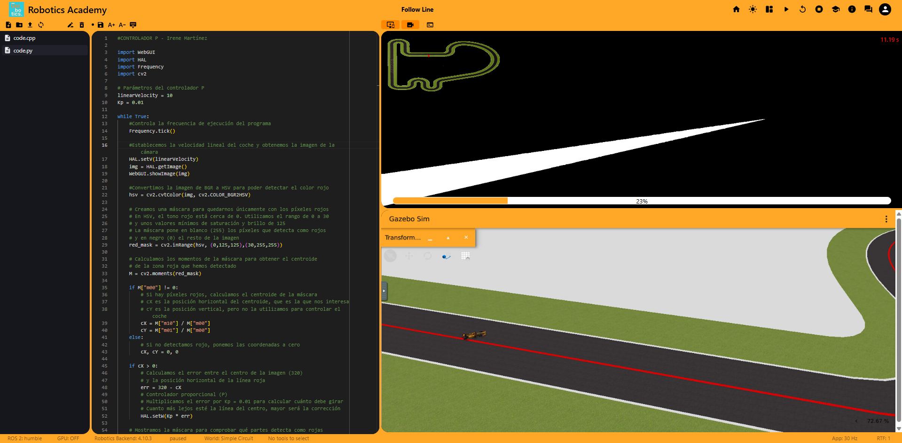


#### P-01 - Velocidad 2, Kp = 0.1
El coche consigue completar el circuito en **294 segundos**. Sigue la línea roja con bastante precisión y apenas presenta oscilaciones, aunque el tiempo de vuelta es demasiado elevado.


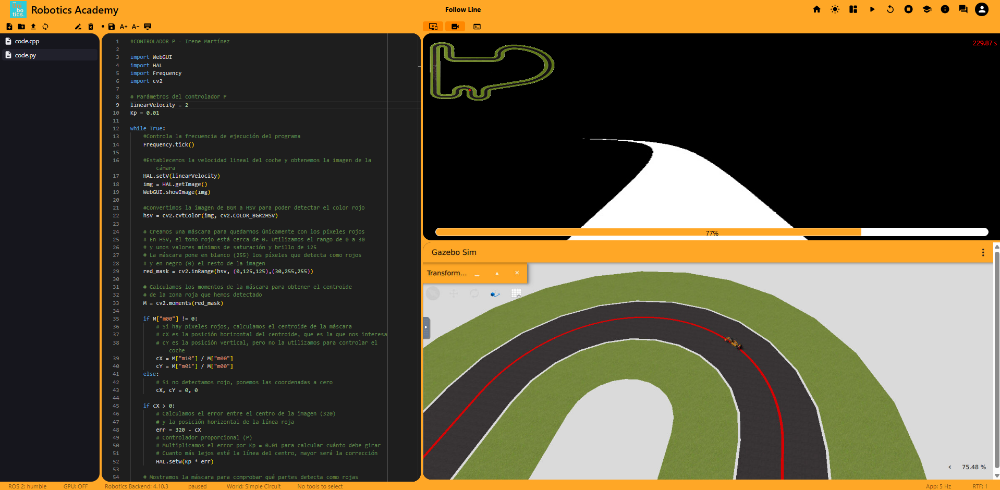

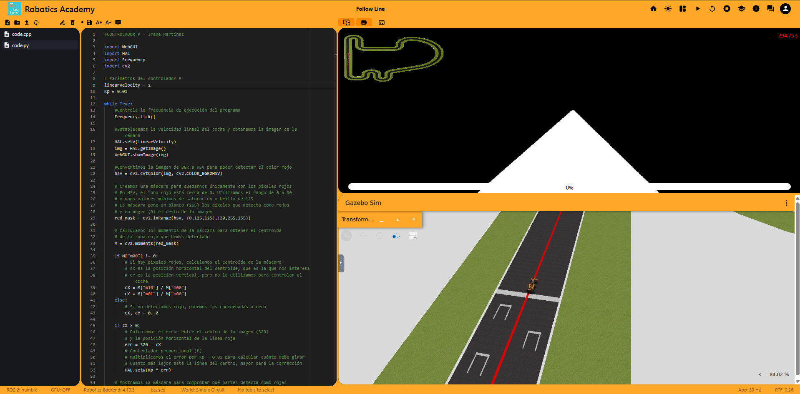

#### P-02 - Velocidad 5, Kp = 0.1
Al aumentar la velocidad, el tiempo de vuelta se reduce a **113 segundos**. El coche se comporta relativamente bien en las rectas, pero empieza a oscilar cuando llega a las curvas.


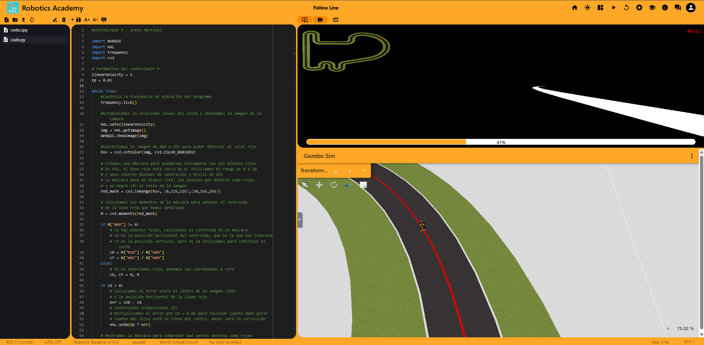

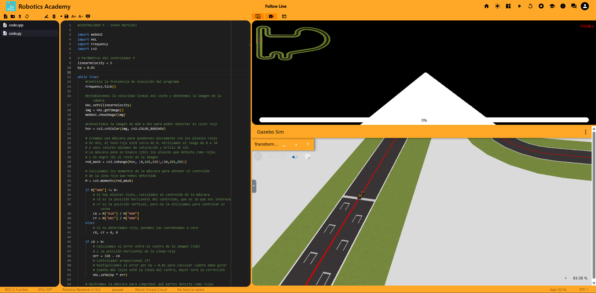

#### P-03 - Velocidad 5, Kp = 0.005

Se reduce la ganancia proporcional para intentar conseguir correcciones más suaves.

El coche completa el circuito en **109 segundos**. Aunque parece oscilar algo menos después de volver hacia la línea, al entrar en algunas curvas se desvía bastante. Por tanto, no se observa una mejora clara respecto a la prueba anterior.

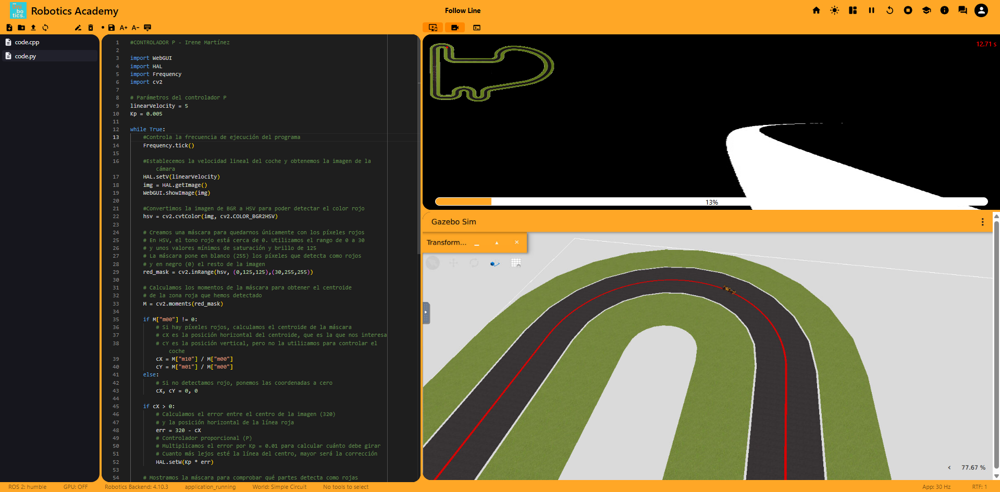

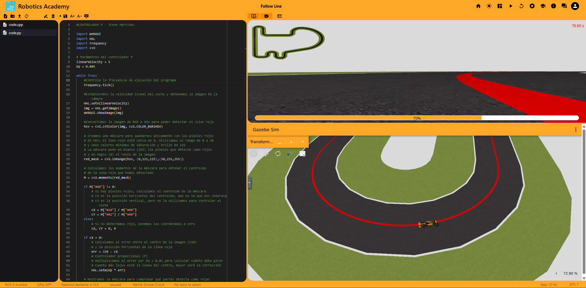

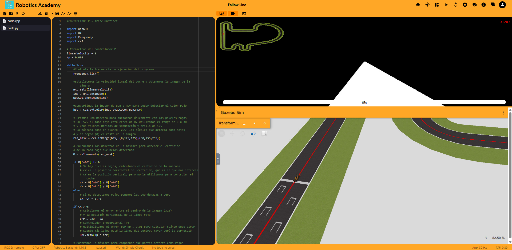

#### P-04 - Velocidad 7, Kp = 0.01

Se prueba una velocidad superior, pero el coche no consigue realizar correctamente la primera curva. La trayectoria es prácticamente recta y termina saliéndose de la carretera.


#### P-05 - Velocidad 6, Kp = 0.01

En esta última prueba se consigue completar el circuito en **96 segundos**, siendo el mejor tiempo obtenido con el controlador P.

Sin embargo, el coche presenta oscilaciones muy grandes, incluso en las rectas. Aunque consigue completar el recorrido, todavía es necesario mejorar la estabilidad.


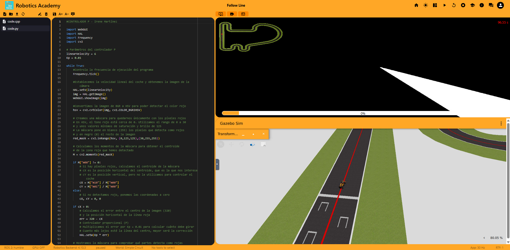

#### Resumen
Las pruebas muestran cómo el aumento de velocidad permite reducir considerablemente el tiempo de vuelta, pero también hace que el vehículo tenga más dificultades para mantenerse cerca de la línea roja.
La configuración P-05 consigue el menor tiempo, aunque sus oscilaciones son demasiado grandes. Por este motivo, en la siguiente fase se probará un controlador PD para intentar conseguir una trayectoria más estable sin perder velocidad.


## 5. Controlador proporcional-derivativo (PD)
Después de realizar las pruebas con el controlador P, se ha implementado un controlador PD para intentar reducir las oscilaciones que presentaba el coche, especialmente cuando circulaba a velocidades más elevadas.
La principal diferencia respecto al controlador anterior es que ahora se añade una parte derivativa, que tiene en cuenta cómo cambia el error entre una iteración y la siguiente.
La expresión del controlador es:
**w = Kp · error + Kd · derivada**

Donde:
- `Kp` es la ganancia proporcional, que determina cuánto se corrige en función del error.
- `Kd` es la ganancia derivativa, que determina cuánto influye la variación del error.
- `w` es la velocidad angular que se aplica al coche.

En este caso, la derivada se calcula de forma aproximada, restando el error anterior al actual:
```python
derivada = err - error_anterior
```

Por tanto, se utiliza la variación del error entre iteraciones, sin dividir por el tiempo transcurrido. Esto simplifica el código, aunque hace que el efecto de `Kd` dependa de la frecuencia con la que se ejecuta el programa.
El controlador combina ambas partes para calcular el giro:

```python
P = Kp * err
D = Kd * derivada

HAL.setW(P + D)
```

La intención es comprobar si, teniendo en cuenta cómo está cambiando el error, el coche consigue realizar correcciones más suaves y mantenerse más cerca de la línea roja.

### 5.1. Pruebas realizadas
Se han realizado seis pruebas con el controlador PD. En las cinco primeras se ha mantenido la velocidad en 6, modificando únicamente la ganancia derivativa (`Kd`) para observar cómo influye en las oscilaciones.
En la última prueba se ha aumentado la velocidad a 7, manteniendo los valores de `Kp` y `Kd` que habían dado mejores resultados de estabilidad.

| Prueba | Velocidad | Kp | Kd | Tiempo |
|---|---:|---:|---:|---:|
| PD-00 | 6 | 0.01 | 0.01 | 94,47 s |
| PD-01 | 6 | 0.01 | 0.05 | 89,11 s |
| PD-02 | 6 | 0.01 | 0.1 | 93,58 s |
| PD-03 | 6 | 0.01 | 0.075 | 96,72 s |
| PD-04 | 6 | 0.01 | 0.035 | 97,16 s |
| PD-05 | 7 | 0.01 | 0.05 | 85,65 s |

Todas las configuraciones han conseguido completar el circuito. Los tiempos corresponden a ejecuciones individuales y las oscilaciones se han valorado mediante la observación del coche durante el recorrido.

### 5.2. Análisis de los resultados
**PD-00 - Velocidad 6, Kp = 0.01, Kd = 0.01**
En la primera prueba se han mantenido los valores de velocidad y ganancia proporcional utilizados en P-05, añadiendo una ganancia derivativa de 0.01.
El coche completa el circuito en 94,47 segundos, pero continúa presentando bastantes oscilaciones.
Aunque el tiempo es ligeramente inferior al obtenido con el controlador P, la diferencia en el comportamiento no resulta demasiado notable. Por ello, se decide aumentar la ganancia derivativa.

**PD-01 - Velocidad 6, Kp = 0.01, Kd = 0.05**
Se aumenta `Kd` hasta 0.05 para comprobar si una mayor influencia de la parte derivativa permite reducir los bandazos.
En esta prueba se observa una mejora bastante clara. El coche continúa realizando algunas correcciones laterales, pero las oscilaciones son mucho menores que en las configuraciones anteriores.
Además, completa el circuito en 89,11 segundos, mejorando el tiempo respecto a PD-00.
Esta es la configuración que ha presentado el comportamiento más estable de las pruebas realizadas con PD, según las observaciones.

**PD-02 - Velocidad 6, Kp = 0.01, Kd = 0.1**
Después de observar la mejora con `Kd = 0.05`, se aumenta la ganancia derivativa hasta 0.1 para comprobar si se consigue reducir todavía más la oscilación.
Sin embargo, el resultado empeora. Aunque en las rectas el coche se comporta relativamente bien, en las curvas vuelve a realizar movimientos laterales bastante pronunciados, llegando a circular prácticamente en zigzag.
El tiempo de vuelta es de 93,58 segundos.
Esta prueba permite observar que aumentar demasiado la ganancia derivativa no garantiza una mejora. En este caso, una corrección excesiva ante las variaciones del error parece provocar movimientos más bruscos.

**PD-03 - Velocidad 6, Kp = 0.01, Kd = 0.075**
Se prueba un valor intermedio entre 0.05 y 0.1 para intentar encontrar una configuración más equilibrada.
El coche completa el recorrido en 96,72 segundos.
Las oscilaciones son menores que con `Kd = 0.1`, pero siguen siendo más pronunciadas que con `Kd = 0.05`.
Por tanto, aunque el comportamiento mejora respecto a PD-02 en cuanto a estabilidad observada, no consigue superar los resultados de PD-01.

**PD-04 - Velocidad 6, Kp = 0.01, Kd = 0.035**
En esta prueba se reduce la ganancia derivativa por debajo de 0.05 para comprobar si una corrección más suave permite mejorar el seguimiento.
Sin embargo, el coche vuelve a presentar bastantes oscilaciones, similares a las observadas con algunos valores de `Kd` más elevados.
El tiempo de vuelta es de 97,16 segundos, siendo el mayor de las pruebas realizadas con PD.
Esto indica que reducir `Kd` tampoco garantiza una trayectoria más estable. En las condiciones de estas pruebas, el valor de 0.05 continúa ofreciendo el mejor comportamiento observado.

**PD-05 - Velocidad 7, Kp = 0.01, Kd = 0.05**
Finalmente, se mantiene la ganancia derivativa que había mostrado mejores resultados (`Kd = 0.05`) y se aumenta la velocidad de 6 a 7.
El coche consigue completar el circuito en 85,65 segundos, siendo el menor tiempo registrado hasta este momento.
Sin embargo, al aumentar la velocidad también aumentan las oscilaciones respecto a PD-01.
Aunque el coche consigue completar el recorrido y mantiene una estabilidad mejor que algunas de las configuraciones anteriores, se observa que una mayor velocidad vuelve a dificultar el seguimiento preciso de la línea roja.
Por tanto, esta prueba consigue mejorar el tiempo, pero a cambio de una trayectoria menos estable.

### 5.3. Conclusiones del controlador PD
Después de realizar las seis pruebas, se observa que añadir el término derivativo permite mejorar el comportamiento del coche respecto al controlador P, aunque es necesario ajustar correctamente su ganancia.
El valor de `Kd` influye considerablemente en las oscilaciones. En nuestro caso, aumentar la ganancia desde 0.01 hasta 0.05 ha permitido conseguir una trayectoria bastante más suave. Sin embargo, tanto los valores superiores como el valor inferior probado han producido mayores oscilaciones.
Esto demuestra que no se trata simplemente de aumentar o reducir `Kd`, sino de encontrar un valor adecuado para las condiciones de funcionamiento del vehículo.

De las pruebas realizadas, destacan dos configuraciones:
- **PD-01 (V = 6, Kp = 0.01, Kd = 0.05):** ha mostrado la trayectoria más estable, completando el circuito en 89,11 segundos.
- **PD-05 (V = 7, Kp = 0.01, Kd = 0.05):** ha conseguido el mejor tiempo, con 85,65 segundos, aunque presenta mayores oscilaciones.

En comparación con el mejor tiempo obtenido mediante el controlador P (96 segundos), el PD ha permitido reducir el tiempo de vuelta. Además, se ha encontrado una configuración con la misma velocidad que el mejor P, pero con una trayectoria notablemente más estable.
Aun así, hay que tener en cuenta que se han realizado pruebas individuales y que las oscilaciones se han valorado visualmente, por lo que no se puede asegurar que los resultados sean siempre iguales.
En general, el controlador PD ha ofrecido mejores resultados que el P, especialmente en cuanto a estabilidad. Sin embargo, sigue existiendo un compromiso entre la velocidad y la precisión del seguimiento.
El siguiente paso será implementar un controlador PID para comprobar si la incorporación de la parte integral permite mejorar todavía más los resultados.

### 5.4. Capturas de las pruebas
A continuación se muestran las capturas realizadas durante los experimentos con el controlador PD. Se incluyen imágenes de las diferentes configuraciones para documentar tanto el funcionamiento del coche como los resultados obtenidos.

#### PD-00 - Velocidad 6, Kp = 0.01, Kd = 0.01
Primera prueba con el controlador PD. El coche completa el circuito en 94,47 segundos, aunque todavía presenta bastantes oscilaciones.


#### PD-01 — Velocidad 6, Kp = 0.01, Kd = 0.05
Se observa una reducción considerable de las oscilaciones. Esta configuración ofrece la mejor estabilidad de las pruebas realizadas con PD, completando el circuito en 89,11 segundos.


#### PD-02 — Velocidad 6, Kp = 0.01, Kd = 0.1
Al aumentar demasiado la ganancia derivativa, vuelven a aparecer oscilaciones pronunciadas, especialmente en las curvas. El tiempo de vuelta es de 93,58 segundos.


#### PD-03 - Velocidad 6, Kp = 0.01, Kd = 0.075
El coche presenta menos oscilaciones que en PD-02, pero continúa siendo menos estable que en PD-01. Completa el circuito en 96,72 segundos.


#### PD-04 - Velocidad 6, Kp = 0.01, Kd = 0.035
Se prueba una ganancia derivativa inferior a 0.05, pero las oscilaciones vuelven a aumentar. El tiempo registrado es de 97,16 segundos.


#### PD-05 - Velocidad 7, Kp = 0.01, Kd = 0.05
En esta última configuración se consigue el mejor tiempo del controlador PD, con 85,65 segundos. El coche completa el circuito, aunque con mayores oscilaciones que a velocidad 6.


Las capturas complementan los resultados de las pruebas y permiten documentar cómo se ha ido ajustando el controlador hasta encontrar una configuración con una estabilidad mejorada y otra con un tiempo de vuelta inferior.

## 6. Controlador proporcional-integral-derivativo (PID)
Después de probar los controladores P y PD, se ha implementado un controlador PID para comprobar si la incorporación de la parte integral permite mejorar el seguimiento de la línea roja.
Este controlador combina tres componentes:
- **Proporcional (P):** corrige la dirección según la distancia entre el centro de la imagen y la línea roja.
- **Integral (I):** acumula los errores de las iteraciones anteriores para intentar corregir desviaciones que se mantienen durante más tiempo.
- **Derivativo (D):** tiene en cuenta cómo está cambiando el error para intentar reducir las oscilaciones.

La expresión del controlador es:
**w = Kp · error + Ki · integral + Kd · derivada**

En el código, la parte integral se calcula acumulando los errores:
```python
error_acumulado += err
I = Ki * error_acumulado
```

Además, se establece un límite para evitar que el error acumulado crezca demasiado y provoque correcciones excesivas. Esta medida ayuda a reducir el problema conocido como *integral windup*.
Al igual que en el controlador PD, se utiliza una implementación discreta simplificada, en la que los errores se acumulan y se comparan entre iteraciones, sin utilizar directamente el tiempo transcurrido.
Finalmente, se suman los tres componentes para calcular la velocidad angular:

```python
P = Kp * err
I = Ki * error_acumulado
D = Kd * derivada

HAL.setW(P + I + D)
```
El objetivo de estas pruebas ha sido encontrar diferentes configuraciones: una que permita seguir la línea de forma estable y otras que consigan completar el circuito más rápidamente, aunque presenten mayores oscilaciones.

### 6.1. Pruebas realizadas
Se han seleccionado tres configuraciones principales, aumentando progresivamente la velocidad para comprobar cómo afecta al comportamiento del coche.

| Prueba | Velocidad | Kp | Ki | Kd | Tiempo |
|---|---:|---:|---:|---:|---:|
| PID-00 | 6 | 0.01 | 0.001 | 0.05 | 90,43 s |
| PID-01 | 8 | 0.01 | 0.001 | 0.05 | 64,86 s |
| PID-02 | 10 | 0.01 | 0.0001 | 0.5 | 53,46 s |

Posteriormente, durante los ajustes de la configuración rápida, también se registró un tiempo de **52,86 segundos**, el menor de toda la práctica. La combinación exacta de ganancias de esa ejecución queda pendiente de verificar con el código guardado.

También se realizaron dos comprobaciones adicionales con velocidad 10 y diferentes ganancias derivativas:
| Configuración adicional | Kd | Resultado |
|---|---:|---|
| Velocidad 10, Kp = 0.01, Ki = 0.0001 | 0.02 | No completa el circuito |
| Velocidad 10, Kp = 0.01, Ki = 0.0001 | 0.04 | 57,92 s, oscilaciones elevadas |

Estas pruebas adicionales permiten observar cómo cambia el comportamiento del coche cuando se modifica la parte derivativa.

### 6.2. Análisis de los resultados
**PID-00 — Velocidad 6: priorizando la estabilidad**

En la primera configuración se utiliza una velocidad de 6, con `Kp = 0.01`, `Ki = 0.001` y `Kd = 0.05`.
El coche consigue completar el circuito en 90,43 segundos y sigue bastante bien la línea roja, prácticamente sin oscilaciones.
El comportamiento es muy estable y las correcciones de dirección son bastante suaves. Sin embargo, el tiempo de vuelta es relativamente elevado en comparación con las configuraciones de mayor velocidad.

Esta prueba resulta interesante porque demuestra que se puede conseguir un seguimiento preciso de la línea sin necesidad de que el coche realice movimientos bruscos continuamente.
Por tanto, se considera la **configuración más estable y controlada de las pruebas PID realizadas**.

**PID-01 — Velocidad 8: buscando un equilibrio**
En la segunda configuración se aumenta la velocidad hasta 8, manteniendo los mismos valores de `Kp`, `Ki` y `Kd`.
El coche consigue completar el circuito en 64,86 segundos, reduciendo considerablemente el tiempo respecto a la primera prueba.
Sin embargo, al aumentar la velocidad también aparecen más oscilaciones. Aunque sigue siendo capaz de completar el recorrido, necesita realizar correcciones laterales más frecuentes.
Esta configuración representa una alternativa intermedia entre la estabilidad del primer PID y la velocidad que se busca conseguir en la práctica.

**PID-02 — Velocidad 10: priorizando el tiempo**
En esta prueba se aumenta la velocidad hasta 10, utilizando `Kp = 0.01`, `Ki = 0.0001` y `Kd = 0.5`.
El coche consigue completar el circuito en 53,46 segundos, mejorando bastante los resultados anteriores.
Sin embargo, el comportamiento es mucho menos estable. Durante el recorrido se producen oscilaciones muy pronunciadas y el vehículo se desplaza continuamente de un lado a otro de la línea.
Aunque consigue mantenerse dentro del circuito y completar la vuelta, la trayectoria no es especialmente precisa.
Durante los ajustes posteriores también se registró un tiempo de 52,86 segundos, el mejor obtenido en toda la práctica.
Por tanto, las configuraciones rápidas han permitido reducir considerablemente el tiempo de vuelta, pero a cambio de una mayor inestabilidad.

**Ajustes adicionales de la ganancia derivativa**
Para comprobar si se podían reducir las oscilaciones a velocidad 10, se modificó la ganancia derivativa.
Con `Kd = 0.2`, el coche terminó saliéndose del circuito, por lo que esta configuración no resultó adecuada.
Posteriormente se probó `Kd = 0.4`, obteniendo un tiempo de 57,92 segundos. El coche consiguió completar el recorrido, pero continuó presentando muchas oscilaciones.
Estos resultados muestran que modificar la ganancia derivativa puede afectar considerablemente al comportamiento del vehículo, aunque no siempre se consigue una mejora.

### 6.3. Conclusiones del controlador PID
Después de realizar las pruebas, se observa que el controlador PID permite completar el circuito con diferentes configuraciones, dependiendo de si se da más importancia a la estabilidad o a la velocidad.
La primera configuración, con velocidad 6, consigue seguir la línea roja de forma bastante precisa y con muy pocas oscilaciones. Aunque su tiempo de 90,43 segundos no es el mejor, ofrece un comportamiento más controlado.
Al aumentar la velocidad a 8, el tiempo se reduce considerablemente hasta 64,86 segundos, aunque aparecen mayores oscilaciones.
Finalmente, con velocidad 10 se consiguen tiempos próximos a 53 segundos, llegando a registrar un mínimo de 52,86 segundos. Sin embargo, el coche realiza movimientos laterales mucho más bruscos y se aleja con mayor frecuencia de la línea roja.
Por tanto, en estas pruebas **la configuración más rápida no es la más estable**.
También se ha comprobado que reducir la ganancia derivativa no siempre mejora el comportamiento. Algunos ajustes han provocado que el coche se salga del circuito o que continúe oscilando demasiado.
En general, el PID ha permitido conseguir tiempos inferiores a los obtenidos anteriormente con P y PD, aunque esto también se debe a que se han probado velocidades más elevadas. No se puede atribuir toda la mejora únicamente al término integral.
Como resultado, se mantienen dos configuraciones de referencia: una que prioriza el seguimiento preciso de la línea y otra que busca completar el circuito en el menor tiempo posible.

### 6.4. Capturas de las pruebas
A continuación se muestran las capturas realizadas durante las pruebas del controlador PID. Estas imágenes sirven para documentar las configuraciones utilizadas y los resultados obtenidos.

#### PID-00 - Velocidad 6: configuración estable
En esta primera prueba, el coche completa el circuito en 90,43 segundos, siguiendo la línea roja con bastante precisión y prácticamente sin oscilaciones.

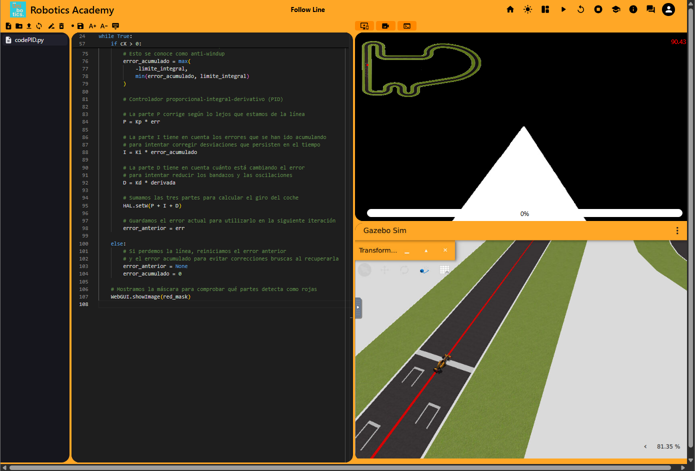

#### PID-01 - Velocidad 8: configuración intermedia

Al aumentar la velocidad hasta 8, el tiempo se reduce a 64,86 segundos, aunque el coche comienza a realizar más correcciones laterales.

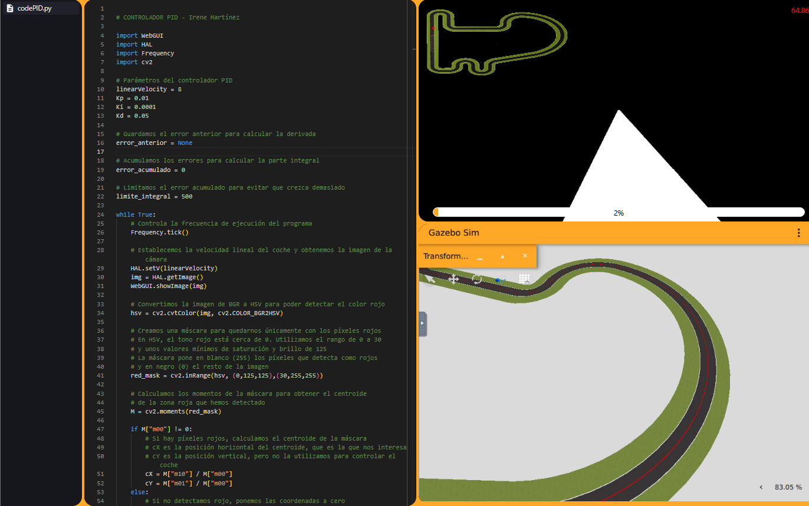

#### PID-02 - Velocidad 10: configuración rápida

Esta configuración permite completar el circuito en 53,46 segundos, aunque con oscilaciones mucho más pronunciadas. Durante la optimización también se consiguió registrar una vuelta de 52,86 segundos.

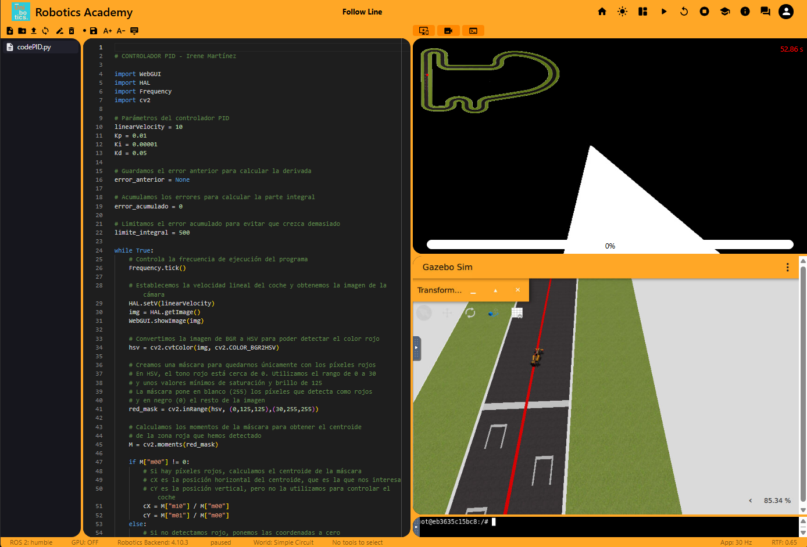

#### Ajuste adicional - Kd = 0.4
En esta prueba se modifica la ganancia derivativa para intentar reducir las oscilaciones a velocidad 10.
El coche completa el recorrido en 57,92 segundos, pero continúa mostrando un comportamiento bastante inestable.

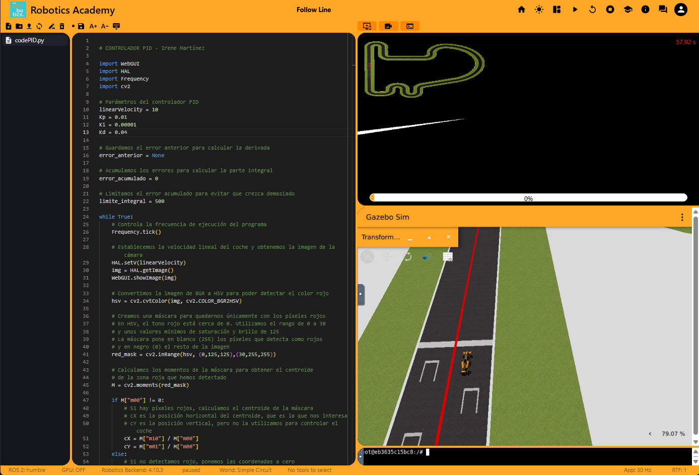

Las capturas permiten complementar los tiempos registrados y mostrar las diferencias de comportamiento entre las distintas configuraciones.
---

## 7. Comparación final de los controladores
Una vez realizadas las pruebas con P, PD y PID, se pueden comparar los resultados obtenidos y analizar cómo ha ido evolucionando el comportamiento del coche.

### 7.1. Comparación de tiempos
La siguiente tabla recoge el menor tiempo registrado con cada tipo de controlador.

| Controlador | Velocidad | Mejor tiempo | Observaciones |
|---|---:|---:|---|
| P | 6 | 96 s | Oscilaciones muy elevadas |
| PD | 7 | 85,65 s | Más estable que algunas configuraciones P, pero sigue oscilando |
| PID | 10 | 52,86 s | Mejor tiempo registrado, con oscilaciones muy pronunciadas |

A lo largo de la práctica se ha pasado de completar el circuito en 96 segundos con el controlador P a conseguir una vuelta de 52,86 segundos durante la fase PID.
Esto supone una reducción aproximada del **45 % del tiempo de vuelta** respecto al mejor resultado obtenido con P.
Sin embargo, hay que tener en cuenta que las configuraciones utilizan velocidades y ganancias diferentes. Por tanto, la mejora no se debe exclusivamente al tipo de controlador, sino también al ajuste de sus parámetros y al aumento de la velocidad.

### 7.2. Comparación del comportamiento
**Controlador P**
Ha permitido comprender el funcionamiento básico del seguimiento de línea y comprobar cómo influye la ganancia proporcional en las correcciones de dirección.
A velocidades bajas, el coche sigue bastante bien la línea, pero al aumentar la velocidad aparecen oscilaciones importantes y existe mayor riesgo de salirse del circuito.

**Controlador PD**
La incorporación del término derivativo ha permitido reducir las oscilaciones en algunas configuraciones.
El valor `Kd = 0.05` ha ofrecido los mejores resultados de estabilidad de las pruebas PD, permitiendo completar el circuito en 89,11 segundos a velocidad 6.
También se ha conseguido mejorar el tiempo hasta 85,65 segundos aumentando la velocidad a 7, aunque con mayores oscilaciones.

**Controlador PID**
Con el PID se han conseguido los tiempos más bajos de toda la práctica.
La configuración de velocidad 6 ha presentado un comportamiento muy estable, mientras que las configuraciones de mayor velocidad han permitido reducir considerablemente el tiempo de vuelta.
Sin embargo, las pruebas no demuestran que añadir el término integral sea siempre mejor. Su efecto depende de los valores elegidos y de las condiciones de funcionamiento del coche.

### 7.3. Selección de las configuraciones finales
Después de comparar los resultados, se han seleccionado dos configuraciones de referencia según el objetivo que se quiera priorizar.

**Configuración más estable**
- Controlador: PID.
- Velocidad: 6.
- Kp: 0.01.
- Ki: 0.001.
- Kd: 0.05.
- Tiempo: 90,43 segundos.

Esta configuración destaca por seguir la línea roja de forma bastante precisa y presentar muy pocas oscilaciones.
Se considera la opción más adecuada si se prioriza la estabilidad y el seguimiento de la línea frente al tiempo de vuelta.

**Configuración más rápida**
La mejor vuelta registrada durante la fase PID ha sido de **52,86 segundos**, utilizando una configuración de velocidad elevada.
El resultado demuestra que es posible completar el circuito en bastante menos tiempo, aunque con mayores oscilaciones y una trayectoria menos controlada.
La configuración rápida documentada con todos sus parámetros es:
- Controlador: PID.
- Velocidad: 10.
- Kp: 0.01.
- Ki: 0.0001.
- Kd: 0.5.
- Tiempo registrado con esta combinación: 53,46 segundos.

En este caso, se prioriza la velocidad, aceptando mayores desviaciones respecto a la línea roja.
Aunque consigue completar el circuito, no presenta la misma estabilidad que la configuración de velocidad 6.

---

## 8. Conclusiones finales
El desarrollo de esta práctica ha permitido comprobar cómo influyen los diferentes controladores y sus parámetros en el comportamiento de un coche autónomo que debe seguir una línea roja.
Al comenzar, se utilizó un controlador proporcional sencillo, con el que se consiguió completar el recorrido, pero aparecieron dificultades al aumentar la velocidad. El coche empezaba a oscilar demasiado e incluso llegaba a salirse en algunas curvas.
Posteriormente, al incorporar el término derivativo mediante el controlador PD, se consiguió mejorar la estabilidad en determinadas configuraciones. Las pruebas también permitieron comprobar que aumentar `Kd` no garantiza un mejor resultado, ya que una corrección demasiado elevada puede producir movimientos bruscos.
Finalmente, se implementó un controlador PID, añadiendo la parte integral para tener en cuenta los errores acumulados. Con este controlador se consiguieron los tiempos más bajos de la práctica, aunque también se observó que aumentar la velocidad provoca mayores oscilaciones.

Una de las conclusiones más importantes es que **no existe una única configuración que sea la mejor en todos los aspectos**. Una velocidad baja facilita seguir la línea con precisión, mientras que una velocidad elevada permite reducir el tiempo de vuelta, pero hace más difícil mantener una trayectoria estable.

También se ha comprobado que los valores de las ganancias deben ajustarse experimentalmente. Un cambio que parece pequeño puede modificar bastante el comportamiento del coche, y no siempre aumentar o reducir un parámetro produce el resultado esperado.

En cuanto al rendimiento, se ha conseguido pasar de los 96 segundos del mejor controlador P a un mínimo de 52,86 segundos durante la fase PID. Esto representa una mejora importante en el tiempo de vuelta, aunque se ha conseguido a costa de una mayor inestabilidad y utilizando una velocidad superior.

Por otra parte, se ha obtenido una configuración PID a velocidad 6 que sigue la línea prácticamente sin oscilaciones, lo que demuestra que también es posible priorizar la precisión del recorrido.

Como posible mejora futura, sería interesante implementar un sistema de velocidad adaptativa, que permita acelerar en las rectas y reducir la velocidad antes de llegar a las curvas. También se podría mejorar la detección de la línea utilizando regiones concretas de la imagen, en lugar de analizarla completa.

Esta práctica ha servido para comprender mejor el funcionamiento de los controladores P, PD y PID, así como la importancia de ajustar sus parámetros y encontrar un equilibrio entre velocidad, precisión y estabilidad.

**Mejor tiempo registrado: 52,86 segundos.**

