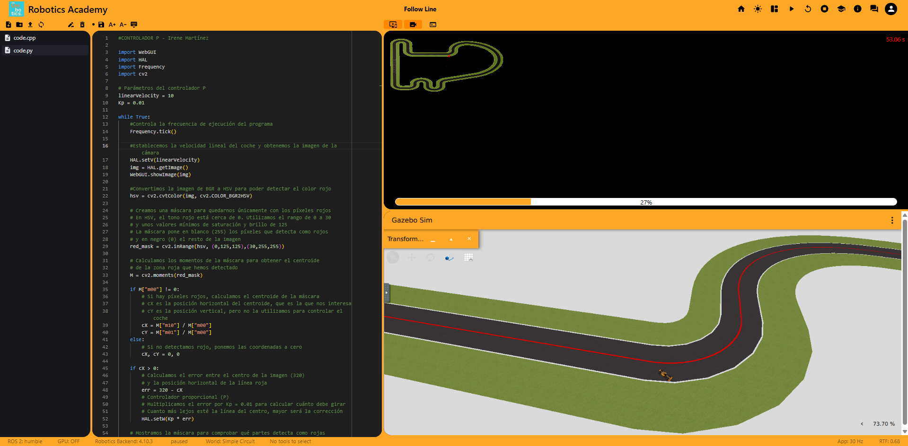
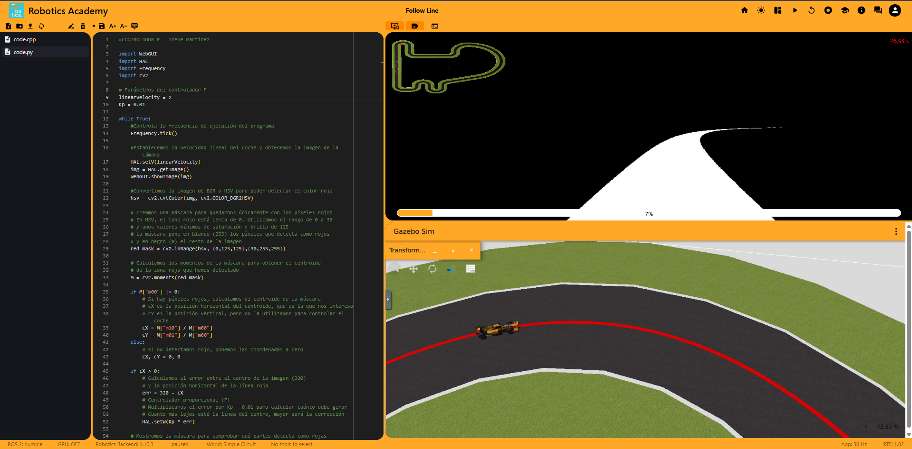
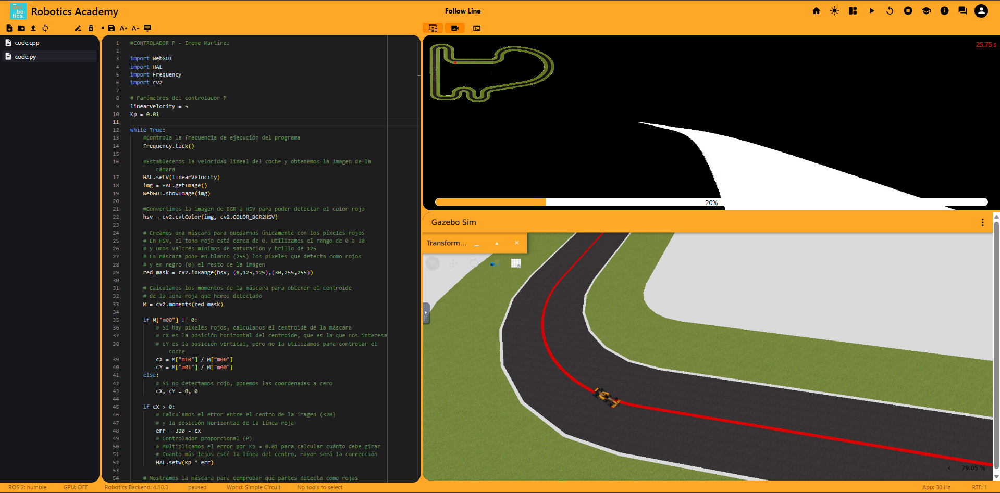
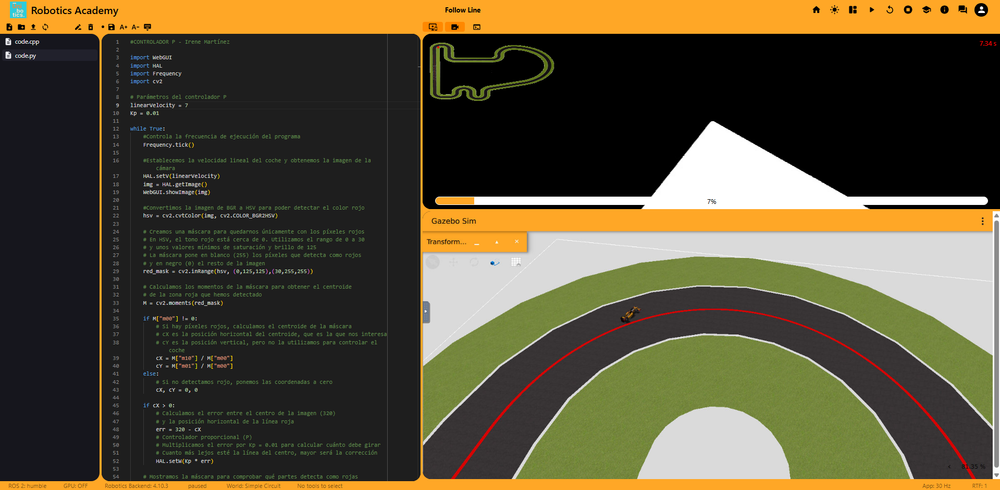
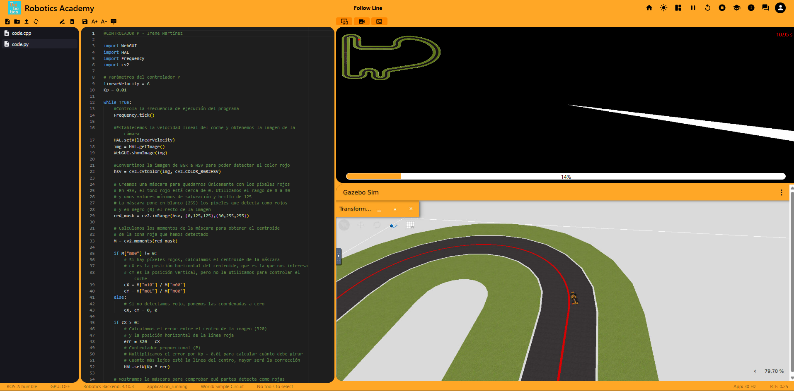

# Follow Line — UniBotics

## 1. Introducción
El objetivo de esta práctica es programar un coche autónomo capaz de seguir una línea roja a lo largo de un circuito utilizando la imagen obtenida por su cámara. Para ello se utiliza el ejercicio *Follow Line* de UniBotics, que permite controlar un vehículo simulado mediante código Python.

El reto no consiste únicamente en completar el circuito, sino en conseguir hacerlo en el menor tiempo posible, manteniendo el coche cerca de la línea roja y evitando oscilaciones excesivas. Para intentar mejorar el comportamiento del vehículo, se van a implementar y comparar tres tipos de controladores:
- **P (Proporcional):** corrige la dirección en función de la distancia entre el coche y la línea.
- **PD (Proporcional-Derivativo):** tiene en cuenta tanto el error como su variación.
- **PID (Proporcional-Integral-Derivativo):** añade un término integral que acumula los errores a lo largo del tiempo.

Durante la práctica se realizarán diferentes pruebas, modificando los parámetros de cada controlador y analizando cómo afectan a la velocidad, la estabilidad y la capacidad del coche para completar el recorrido.

## 2. Entorno de trabajo
Para desarrollar la práctica se han utilizado las siguientes herramientas:
- **UniBotics Robotics Academy:** plataforma donde se ejecuta el ejercicio Follow Line.
- **Gazebo Sim:** simulador del coche y del circuito.
- **Python:** lenguaje utilizado para programar el comportamiento del vehículo.
- **OpenCV:** librería utilizada para procesar las imágenes y detectar la línea roja.
- **Docker Desktop y WSL2:** permiten ejecutar el Robotics Backend de UniBotics en Windows.

### 2.1. Instalación y ejecución en Windows
Para ejecutar la simulación en Windows es necesario tener instalado Docker Desktop con WSL2.
En primer lugar, se descarga la imagen del Robotics Backend:
```bash
docker pull jderobot/robotics-backend:latest
```
Una vez descargada, se inicia el contenedor con el siguiente comando:
```bash
docker run --rm -it -p 6080-6090:6080-6090 -p 1108:1108 -p 7163:7163 jderobot/robotics-backend:latest
```
En esta práctica se utiliza el modo sin aceleración gráfica NVIDIA.

Después se accede a [UniBotics](https://unibotics.org/) y se realizan los siguientes pasos:
1. Iniciar sesión en la plataforma.
2. Seleccionar **Local ROS2 (Robotics Backend 4)** en la configuración del perfil.
3. Entrar en **Robotics Academy → Free Course → Follow Line**.
4. Pulsar **Click to connect** para conectar con el simulador local.
5. Copiar el código Python en el editor, reiniciar el circuito y ejecutar el programa.

Es importante mantener el contenedor de Docker en ejecución mientras se utiliza UniBotics.

## 3. Detección de la línea roja
Antes de controlar el movimiento del coche, es necesario detectar dónde se encuentra la línea roja. Para ello se utiliza la cámara del vehículo y la librería OpenCV. El proceso comienza obteniendo una imagen de la cámara:

```python
img = HAL.getImage()
```

A continuación, se convierte la imagen del espacio de color BGR a HSV:
```python
hsv = cv2.cvtColor(img, cv2.COLOR_BGR2HSV)
```

El espacio HSV permite trabajar con el tono, la saturación y el brillo de los colores, lo que facilita la detección de la línea roja.
Después se crea una máscara utilizando un rango de valores HSV:

```python
red_mask = cv2.inRange(hsv, (0,125,125), (30,255,255))
```
La máscara convierte en blanco los píxeles que están dentro del rango seleccionado y deja en negro el resto de la imagen. De esta forma, se puede distinguir la región detectada como roja del resto del circuito.

### 3.1. Cálculo del centroide
Una vez obtenida la máscara, se calculan sus momentos:
```python
M = cv2.moments(red_mask)
```

A partir de estos valores se obtiene el centroide de la región detectada:
```python
cX = M["m10"] / M["m00"]
cY = M["m01"] / M["m00"]
```

La coordenada `cX` indica la posición horizontal del centroide y es la que interesa para controlar el coche.
La coordenada `cY` representa su posición vertical, aunque no se utiliza en este primer controlador.

Finalmente, se calcula el error entre el centro de la imagen y la posición horizontal de la línea:
```python
err = 320 - cX
```
En este caso se utiliza 320 porque se considera una imagen de 640 píxeles de ancho.

Si el centroide coincide con el centro de la imagen, el error es cero. Si se desplaza hacia uno de los lados, el error cambia de valor y el controlador debe corregir la dirección.

## 4. Controlador proporcional (P)
El primer controlador utilizado es el proporcional o P.
Su funcionamiento es sencillo: cuanto mayor sea el error entre el centro de la imagen y la línea roja, mayor será la corrección que se aplica a la dirección del coche.

La velocidad angular se calcula mediante:
**w = Kp · error**

Donde:
- `w` es la velocidad angular del coche.
- `Kp` es la ganancia proporcional.
- `error` es la diferencia entre el centro de la imagen y el centroide de la línea detectada.

En Python se implementa de la siguiente manera:
```python
HAL.setW(Kp * err)
```

Por otra parte, la velocidad lineal se establece mediante:
```python
HAL.setV(linearVelocity)
```

Los dos parámetros que se han modificado durante las pruebas son `linearVelocity` y `Kp`. La idea inicial es comprobar cómo afecta el aumento de velocidad al seguimiento de la línea y si modificando la ganancia proporcional se consigue reducir la oscilación del vehículo.

### 4.1. Pruebas realizadas
Se han realizado seis pruebas con diferentes configuraciones del controlador P.

| Prueba | Velocidad | Kp | Tiempo | Resultado |
|---|---:|---:|---:|---|
| P-00 | 10 | 0.1 | — | Se sale en la tercera curva. |
| P-01 | 2 | 0.1 | 294 s | Completa, casi sin oscilaciones. |
| P-02 | 5 | 0.1 | 113 s | Completa, oscila en las curvas. |
| P-03 | 5 | 0.005 | 109 s | Completa, se desvía bastante al entrar en las curvas. |
| P-04 | 7 | 0.01 | — | Se sale en la primera curva. |
| P-05 | 6 | 0.01 | 96 s | Completa, pero oscila muchísimo. |

Los tiempos corresponden a las vueltas completadas en las pruebas realizadas. En los intentos en los que el coche se salió del circuito no se registra un tiempo de vuelta.

### 4.2. Análisis de los resultados
**P-00 — Velocidad 10, Kp = 0.1**

En la primera configuración se utiliza una velocidad elevada. El coche consigue avanzar por el circuito, pero termina saliéndose en la tercera curva.

Se observa que esta combinación de parámetros no permite completar el recorrido correctamente.

**P-01 - Velocidad 2, Kp = 0.1**
Se reduce considerablemente la velocidad para comprobar si el coche es capaz de seguir la línea con mayor precisión.
En esta prueba completa el circuito en 294 segundos. El seguimiento de la línea es bastante bueno y prácticamente no se observan oscilaciones.
El principal inconveniente es el tiempo: el coche va demasiado despacio para el objetivo de la práctica.

**P-02 - Velocidad 5, Kp = 0.1**
Se aumenta la velocidad hasta 5, manteniendo la misma ganancia proporcional.
El coche completa el circuito en 113 segundos, reduciendo bastante el tiempo respecto a la prueba anterior.
En las rectas se comporta relativamente bien, pero al llegar a las curvas empieza a oscilar de un lado a otro.

**P-03 - Velocidad 5, Kp = 0.005**
Se mantiene la velocidad en 5, pero se reduce la ganancia proporcional para comprobar si las correcciones más suaves mejoran el comportamiento.
El coche completa la vuelta en 109 segundos.
Al observarlo, se aprecia que al entrar en algunas curvas se aleja bastante de la línea, llegando a dar un bandazo más fuerte que en la prueba anterior. Después, cuando vuelve hacia la línea, parece que oscila algo menos.
Sin embargo, la diferencia general respecto a P-02 no resulta demasiado clara. Aunque el tiempo es ligeramente inferior, no se puede afirmar que esta configuración sea mejor, ya que el coche también presenta desviaciones importantes.

**P-04 - Velocidad 7, Kp = 0.01**
Se prueba una velocidad superior, utilizando una ganancia proporcional de 0.01.
En este caso, el coche se sale en la primera curva, prácticamente siguiendo una trayectoria recta y sin corregir lo suficiente para mantenerse sobre la línea.
Esta configuración no permite completar el circuito.

**P-05 - Velocidad 6, Kp = 0.01**
Se reduce la velocidad a 6, manteniendo la ganancia proporcional de la prueba anterior.
El coche consigue completar el circuito en 96 segundos, siendo el mejor tiempo obtenido hasta el momento con el controlador P.
Sin embargo, se observan oscilaciones muy grandes, incluso en las rectas. El coche corrige continuamente su dirección y se mueve bastante de un lado a otro de la carretera.
Por tanto, aunque es la configuración más rápida de las que han completado la vuelta, todavía tiene bastante margen de mejora en cuanto a estabilidad.

### 4.3. Conclusiones del controlador P
Después de realizar las pruebas, se observa que la velocidad y la ganancia proporcional influyen considerablemente en el comportamiento del coche.
A velocidades bajas, el seguimiento de la línea es mucho más estable, pero el tiempo necesario para completar el circuito aumenta demasiado.
Al aumentar la velocidad, el coche consigue reducir el tiempo de vuelta, aunque aparecen oscilaciones cada vez más importantes y existe mayor riesgo de salirse de la carretera.
También se ha comprobado que reducir `Kp` no siempre mejora el resultado. En algunas curvas, una corrección demasiado suave hace que el coche se aleje bastante de la línea antes de volver hacia ella.
El mejor tiempo registrado con el controlador P ha sido de **96 segundos**, utilizando una velocidad de 6 y una ganancia proporcional de 0.01.
Sin embargo, esta configuración presenta muchas oscilaciones, por lo que no puede considerarse óptima en términos de estabilidad.

Por este motivo, el siguiente paso será implementar un **controlador PD**, añadiendo un término derivativo para intentar reducir las oscilaciones sin perder demasiada velocidad.


### 4.4. Capturas de las pruebas
A continuación se muestran las capturas de los experimentos realizados con el controlador P. Se incluyen tanto las pruebas en las que el coche ha conseguido completar el circuito como aquellas en las que se ha salido de la carretera.

Las imágenes permiten observar el comportamiento del vehículo con diferentes velocidades y ganancias proporcionales.

#### P-00 - Velocidad 10, Kp = 0.1
En la primera prueba, el coche consigue avanzar por el circuito, pero termina saliéndose en la tercera curva. Esta configuración no permite completar el recorrido.




#### P-01 - Velocidad 2, Kp = 0.1
El coche consigue completar el circuito en **294 segundos**. Sigue la línea roja con bastante precisión y apenas presenta oscilaciones, aunque el tiempo de vuelta es demasiado elevado.




#### P-02 - Velocidad 5, Kp = 0.1
Al aumentar la velocidad, el tiempo de vuelta se reduce a **113 segundos**. El coche se comporta relativamente bien en las rectas, pero empieza a oscilar cuando llega a las curvas.




#### P-03 - Velocidad 5, Kp = 0.005

Se reduce la ganancia proporcional para intentar conseguir correcciones más suaves.

El coche completa el circuito en **109 segundos**. Aunque parece oscilar algo menos después de volver hacia la línea, al entrar en algunas curvas se desvía bastante. Por tanto, no se observa una mejora clara respecto a la prueba anterior.


#### P-04 - Velocidad 7, Kp = 0.01

Se prueba una velocidad superior, pero el coche no consigue realizar correctamente la primera curva. La trayectoria es prácticamente recta y termina saliéndose de la carretera.



#### P-05 - Velocidad 6, Kp = 0.01

En esta última prueba se consigue completar el circuito en **96 segundos**, siendo el mejor tiempo obtenido con el controlador P.

Sin embargo, el coche presenta oscilaciones muy grandes, incluso en las rectas. Aunque consigue completar el recorrido, todavía es necesario mejorar la estabilidad.




#### Resumen

Las pruebas muestran cómo el aumento de velocidad permite reducir considerablemente el tiempo de vuelta, pero también hace que el vehículo tenga más dificultades para mantenerse cerca de la línea roja.

La configuración P-05 consigue el menor tiempo, aunque sus oscilaciones son demasiado grandes. Por este motivo, en la siguiente fase se probará un controlador PD para intentar conseguir una trayectoria más estable sin perder velocidad.

